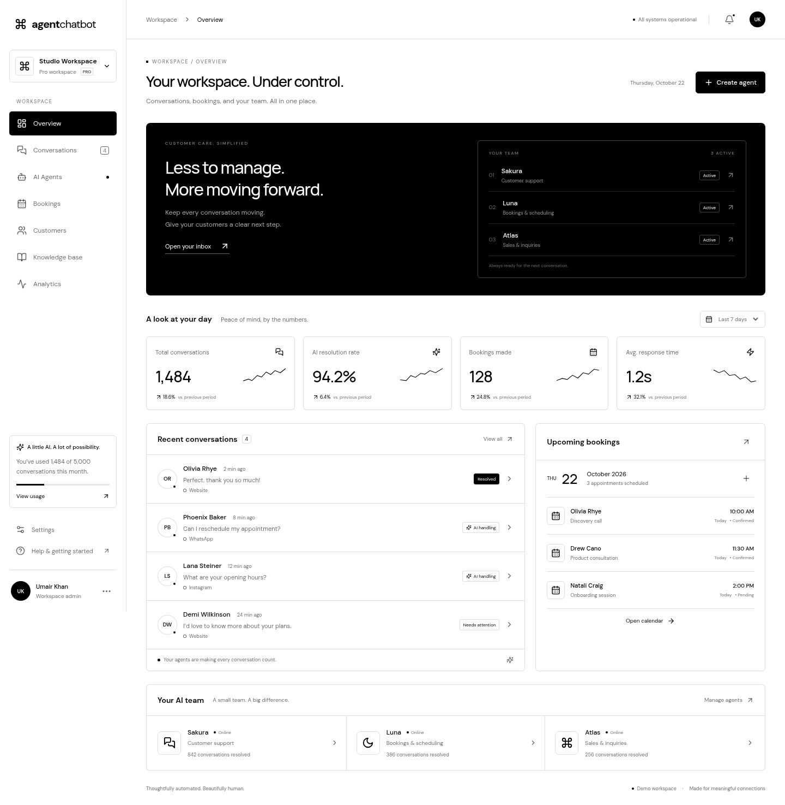
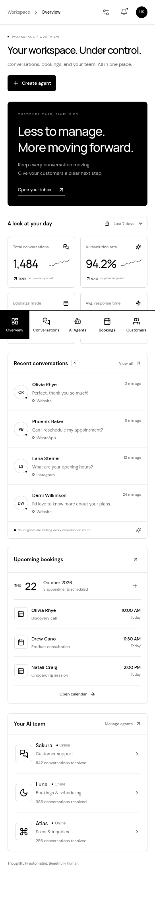

# Agent Chatbot

A clean, **black-and-white** workspace for customer conversations, AI teammates, and bookings. Built for a clear desktop presentation and practical mobile use.

Built with **React 19, TypeScript, and Vite**. This repository contains an interactive frontend demo. It runs without API keys, a database, or paid services.

## Preview



<details>
<summary>See the mobile composition</summary>



</details>

## Contents

- [Quick start](#quick-start)
- [Design direction](#design-direction)
- [What you can do](#what-you-can-do)
- [Technology and structure](#technology-and-structure)
- [Demo data and persistence](#demo-data-and-persistence)
- [Accessibility and motion](#accessibility-and-motion)
- [Verification](#verification)
- [Deploy to Vercel](#deploy-to-vercel)
- [Production integration boundaries](#production-integration-boundaries)

## Quick start

### Requirements

- Node.js **22.12+**, or **24 LTS**. Development was verified with Node.js 24.19.
- npm and Git.

```sh
git clone https://github.com/umairrrkhan/agentchatbot.git
cd agentchatbot
npm ci
npm run dev
```

Open the local URL printed by Vite, normally `http://localhost:5173`.

### Commands

| Command           | Purpose                                                                                |
| ----------------- | -------------------------------------------------------------------------------------- |
| `npm ci`          | Install the exact versions recorded in `package-lock.json`.                            |
| `npm run dev`     | Start Vite with hot reload. The server binds to all interfaces for workspace previews. |
| `npm run build`   | Type-check TypeScript, then create the optimized static build in `dist/`.              |
| `npm run preview` | Serve the production build locally; run the build first.                               |

No `.env` file is required for the demo. The application makes no model, messaging, or calendar API requests.

## Design direction

The interface uses only black and white, with black opacity for secondary text and fine borders. There are no colored accents, gradients, floral illustrations, glass effects, or decorative animations.

- **White surfaces and black type:** clear information hierarchy without scattered color.
- **Black primary actions:** obvious, consistent controls with visible keyboard focus.
- **Simple panels:** restrained borders and spacing instead of decorative shadows.
- **Self-hosted fonts:** DM Sans and Manrope variable fonts load from the app itself.
- **Compact summary:** a practical inbox action and team status replace the decorative hero.
- **Monochrome favicon:** matches the interface and browser theme.

### Mobile layout

- At widths below 760px, the sidebar becomes a fixed bottom navigation bar.
- The navigation scrolls horizontally so every workspace section remains reachable. Settings has its own button in the header.
- Safe-area padding keeps the bar and page content clear of phone home indicators.
- Metric cards use two columns; conversation, booking, and agent panels stack vertically.
- On narrow phones, the duplicate team summary is omitted from the hero; agents remain available in the team panel and navigation.
- Form inputs use 16px text on phones to avoid automatic input zoom in mobile Safari.
- Dialogs fit the available viewport, with scrolling for long threads and forms.
- All screens are usable without hover. There is no decorative motion.

## What you can do

| Screen             | Interactive behavior                                                                                                                       |
| ------------------ | ------------------------------------------------------------------------------------------------------------------------------------------ |
| **Overview**       | See sample metrics, change the metric date-range selector, open customer threads, create bookings, and navigate to agents or the calendar. |
| **Conversations**  | Search customer names and latest messages; filter by status; open a thread; send a local reply; resolve or reopen a conversation.          |
| **AI Agents**      | Create an agent with a unique name and one of three specialties; pause or reactivate agents.                                               |
| **Bookings**       | Create an appointment with a customer name, service, date, and time; cancel an appointment.                                                |
| **Customers**      | Open the customer’s conversation from the directory.                                                                                       |
| **Knowledge base** | Expand and edit knowledge sources; add another source.                                                                                     |
| **Analytics**      | Explore an illustrative weekly volume chart and sample summary values.                                                                     |
| **Settings**       | Rename the workspace and select a timezone.                                                                                                |
| **Notifications**  | Review a demo activity summary and jump to conversations needing attention.                                                                |
| **Help**           | Read a short guide to the interactive demo.                                                                                                |

**Metrics are illustrative.** The date selector changes selected demonstration values; analytics do not aggregate all local interactions. The timezone setting is a saved preference, not a scheduling conversion engine. Sample appointment dates are intentionally fixed for a repeatable demo.

## Technology and structure

| Technology                | Role                                                                   |
| ------------------------- | ---------------------------------------------------------------------- |
| React 19                  | Component rendering, local state, events, and modal lifecycle.         |
| TypeScript                | Typed conversations, messages, bookings, and component props.          |
| Vite 6                    | Development server, optimized production bundling, and asset handling. |
| Lucide React              | Consistent interface icons.                                            |
| Fontsource variable fonts | Locally served DM Sans and Manrope; no Google Fonts request.           |
| Plain CSS                 | Monochrome theme, responsive layouts, and component styling.           |

```text
agentchatbot/
├── docs/
│   ├── desktop-preview.png     # Screenshot of the current desktop design
│   └── mobile-preview.png      # Screenshot of the current mobile design
├── public/
│   └── favicon.svg             # Monochrome chat brand mark
├── src/
│   ├── main.tsx                # App, seed data, local persistence, and views
│   └── style.css               # Shared theme, layouts, motion, and responsive rules
├── index.html                  # Entry document, metadata, and light browser theme
├── package.json                # Runtime dependencies and development scripts
├── package-lock.json           # Reproducible npm dependency versions
├── tsconfig.json               # Strict TypeScript configuration
├── vite.config.ts              # Vite React plugin
└── vercel.json                 # Vite build/output settings for Vercel
```

Navigation switches local views in React state. There are no server routes, URL-based page routes, or client routing dependencies. Refreshing returns to Overview while retaining saved browser data.

## Demo data and persistence

The app starts with four sample conversations, three sample bookings, three agents, and three knowledge sources. Changes are stored in `localStorage` using versioned keys:

| Key                   | Stored value                                              |
| --------------------- | --------------------------------------------------------- |
| `ac-v1-conversations` | Customer threads, latest messages, and resolution status. |
| `ac-v1-bookings`      | Appointments, including cancelled records.                |
| `ac-v1-agents`        | Agent names, specialties, and active state.               |
| `ac-v1-docs`          | Knowledge source titles and content.                      |
| `ac-v1-workspace`     | Workspace display name.                                   |
| `ac-v1-timezone`      | Selected timezone.                                        |

Data stays in the current browser and origin. It does not synchronize across devices, deployments, or users. If browser storage is unavailable, interactions remain usable in memory for the session. Cancelled bookings are retained in storage but hidden from the active schedule.

### Reset the demo

In the browser’s developer console, run:

```js
for (const key of Object.keys(localStorage)) {
  if (key.startsWith("ac-v1-")) localStorage.removeItem(key);
}
location.reload();
```

This removes only this demo’s data keys. Avoid entering real customer or sensitive data into this public demo.

## Accessibility and motion

- Navigation buttons retain accessible names when their visible labels collapse on mobile.
- The selected navigation item exposes `aria-current`.
- Dialogs have accessible labels and `aria-modal`.
- Dialog focus stays within the controls; Escape closes a dialog and restores focus to the trigger.
- Background scrolling is locked while a dialog is open.
- Inputs and selectors have associated labels or explicit accessible names.
- Status messages use `role="status"`.
- Decorative SVGs and hero artwork are hidden from assistive technology.
- Focus indicators remain visible; reduced-motion preferences disable animation.

These features were checked during implementation. The project has not undergone a formal accessibility audit.

## Verification

The current revision was checked with:

- `npm run build`: TypeScript and optimized Vite build completed successfully.
- Desktop and mobile browser inspection of the monochrome theme and panel layout.
- Agent creation and pause/reactivation controls.
- Conversation search, opening a thread, and sending a local reply.
- Booking creation, persistence after refresh, and cancellation.
- Knowledge source creation and editing.
- Mobile horizontal-overflow check.
- Browser runtime error collection during the interaction checks.

The browser checks used Playwright with Chromium as an implementation-time smoke check. They are not an installed repository test suite. Screenshot previews use seed data rather than test-created customers.

For manual acceptance, try the workflows above, refresh the page, and confirm that the saved data persists. Test at a narrow phone width as well as a desktop width. The current design uses a still composition.

## Deploy to Vercel

### Git integration — recommended

1. Sign in to [Vercel](https://vercel.com/new).
2. Select the intended Vercel workspace.
3. Import `umairrrkhan/agentchatbot` from GitHub.
4. Use these settings:

| Setting               | Value                                                           |
| --------------------- | --------------------------------------------------------------- |
| Framework             | Vite                                                            |
| Root directory        | Repository root                                                 |
| Install command       | Default npm install behavior                                    |
| Build command         | `npm run build`                                                 |
| Output directory      | `dist`                                                          |
| Node.js               | 24.x, or another version compatible with the requirements above |
| Environment variables | None required                                                   |

5. Deploy and open the assigned URL.
6. In the project’s Git settings, confirm `main` is the production branch. Future pushes to that branch can trigger production deployments through the Vercel Git integration.

`vercel.json` records the framework, build command, and output directory. Every screen is part of the single app entry point, so no extra route rewrites are needed.

### Optional CLI deployment

With the Vercel CLI installed and authenticated:

```sh
vercel link
vercel project inspect --non-interactive
vercel deploy
```

Check that the inspected project and owner are the intended destination. Review the preview before a production release:

```sh
vercel deploy --prod
```

### Workspace access errors

A `403` mentioning a team/workspace scope indicates that the connected Vercel authorization cannot access that workspace. It does not indicate a failed application build. Team access must be authorized for the same workspace used by the project. Chat approval alone does not change the provider’s connection scopes.

The repository and build are ready for deployment; a live URL should only be reported after Vercel confirms a successful deployment. No deployment URL is hardcoded in this README.

## Production integration boundaries

This demo does **not** currently include:

- A model provider or autonomous AI runtime.
- Live WhatsApp, Instagram, email, or website messaging integrations.
- Calendar synchronization, customer reminders, or confirmation delivery.
- Authentication, server-side authorization, or multiple real workspace members.
- A shared database, durable backend, or server-side reporting.
- Live service health checks or live business analytics.

The example conversations, agent roles, online indicators, and system status are demonstration content. Replies and booking actions affect local data only. Before using this app with real customers, connect these boundaries to authenticated server APIs and durable storage, then validate the complete live flow.
